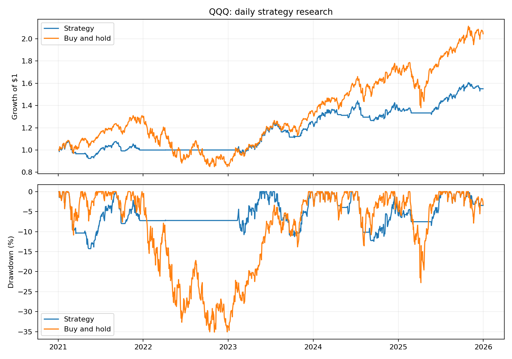

# Market Signal Lab

Python research project exploring the return/drawdown tradeoff of EMA trend filters, RSI/ATR pullback entries, and volatility-based position sizing. Includes a runnable daily backtest and an archive of earlier experiments with optional Discord alerts.



## Example result

Daily adjusted QQQ prices, January 4, 2021–December 31, 2025. Downloaded October 17, 2026. Both portfolios include a 0.1% one-way transaction-cost approximation; cash earns zero interest.

| Portfolio | Total return | Maximum drawdown |
|---|---:|---:|
| EMA/RSI/ATR strategy | 55.05% | -14.26% |
| QQQ buy and hold | 104.45% | -35.12% |

The strategy reduced historical drawdown but captured less upside. These results are exploratory and are not held-out evidence of future performance. The new runner uses explicit timing and warm-up conventions, so results differ from the archived notebook.

## Run it

Tested locally with Python 3.11. No Discord account or webhook is needed.

```powershell
python -m venv .venv
.venv\Scripts\Activate.ps1
python -m pip install -r requirements.txt
python -m market_signal_lab --ticker QQQ --start 2021-01-01 --end 2026-01-01
```

The default output folder is `results/`. Each run saves the downloaded prices (including warm-up history), daily backtest calculations, a JSON summary with dates and parameters, and a performance chart. The end date is exclusive. Downloading requires network access.

Reproduce the example using the saved price snapshot, without downloading again:

```powershell
python -m market_signal_lab --csv results/qqq-daily/prices.csv --start 2021-01-01 --end 2026-01-01 --output results/reproduced
python -m unittest discover -s tests -v
```

Direct dependencies are pinned to the local validation environment; a complete cross-platform lockfile is not provided.

## Strategy and accounting

- Compute EMA(50), EMA(200), RSI(3), ATR(14), and the 20-bar rolling high.
- Enter above EMA(200) when RSI is below 30 or price is more than 1.5 ATR below the rolling high.
- Select 50% exposure when normalized ATR is above 1.2 times its trailing average; otherwise select 100%. Exposure can change on subsequent qualifying entries.
- Exit below EMA(50); an exit takes precedence over an entry.
- Require 200 prior bars to warm up the EMA. Each evaluation starts in cash.
- A signal at close t first affects the return from close t+1 to close t+2. This conservative two-bar lag avoids crediting the next full bar to an unavailable fill, but remains a close-to-close approximation rather than a next-open execution model.
- Charge `--cost` times the absolute change in exposure. Buy-and-hold pays its entry cost. No terminal liquidation is charged to either portfolio.

## Files

```text
market_signal_lab/
  indicators.py           # Shared indicator calculations
  backtest.py             # Signals, exposure, costs, and metrics
  __main__.py             # Command-line runner and chart export
notebooks/strategy_experiments.ipynb  # Earlier experimental versions
results/qqq-daily/         # Dated example inputs and generated results
tests/                    # Future-data invariance, timing/costs, warm-up checks
.github/workflows/        # Automated Python tests
```

## Original notebook and optional alerts

```powershell
python -m pip install -r requirements-notebook.txt
jupyter lab notebooks/strategy_experiments.ipynb
```

The notebook preserves earlier intraday/hourly/daily strategies and QQQ/TQQQ allocation experiments. Run experiments selectively: cells redefine functions, and the first cell starts a continuous polling loop. This archive has not been rerun or audited end-to-end.

Only the alert prototype needs `DISCORD_WEBHOOK_URL`. Set it in the environment before launching Jupyter; `.env.example` is documentation, not an automatically loaded file. Never commit a real webhook. The alert prototype retains basic in-memory cooldowns and does not execute broker orders.

## Limitations and next steps

This is rule-based research, not a trained price prediction model. Repeated tuning in the original notebook used overlapping periods; the published example is retrospective, not a held-out test. Daily adjusted prices can be revised by the provider. Execution omits spreads, next-open fills, taxes, and cash interest. Volatility sizing is a heuristic, not risk parity.

The legacy mixed-timeframe notebook still needs a timestamp/look-ahead audit. Its alert sizing is not cash-capped, and delivery handling remains basic. Next steps are walk-forward evaluation, additional symbols and regimes, and improved optional alerts.
